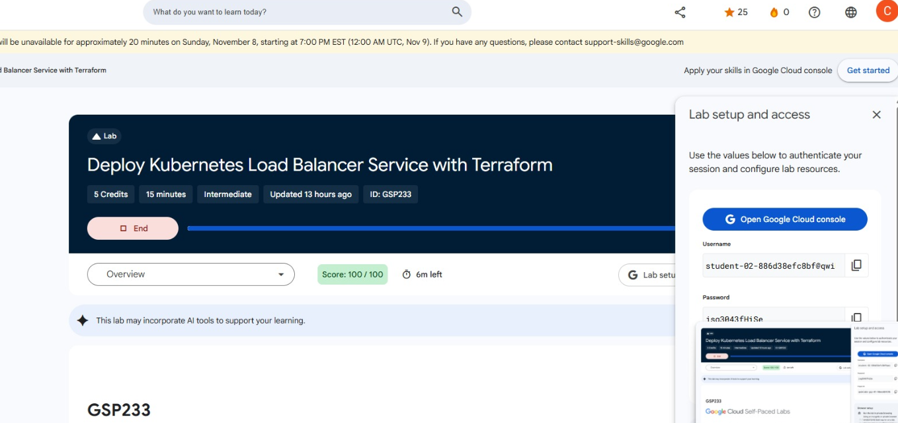
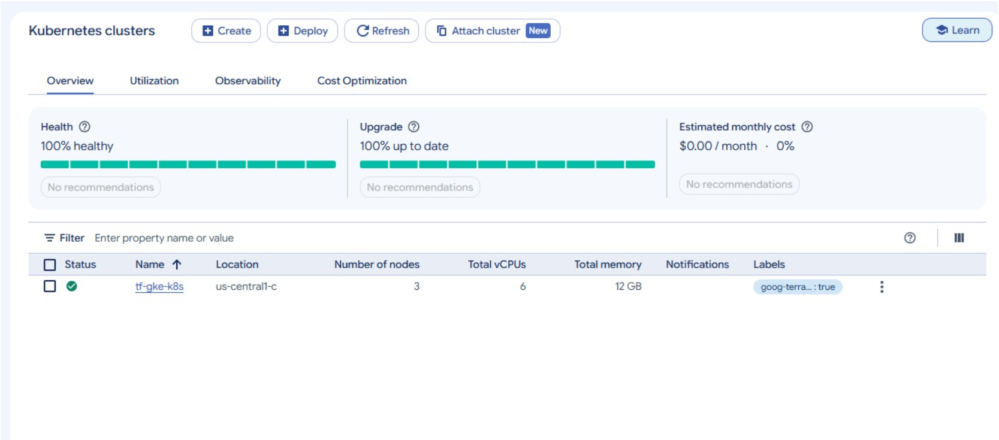
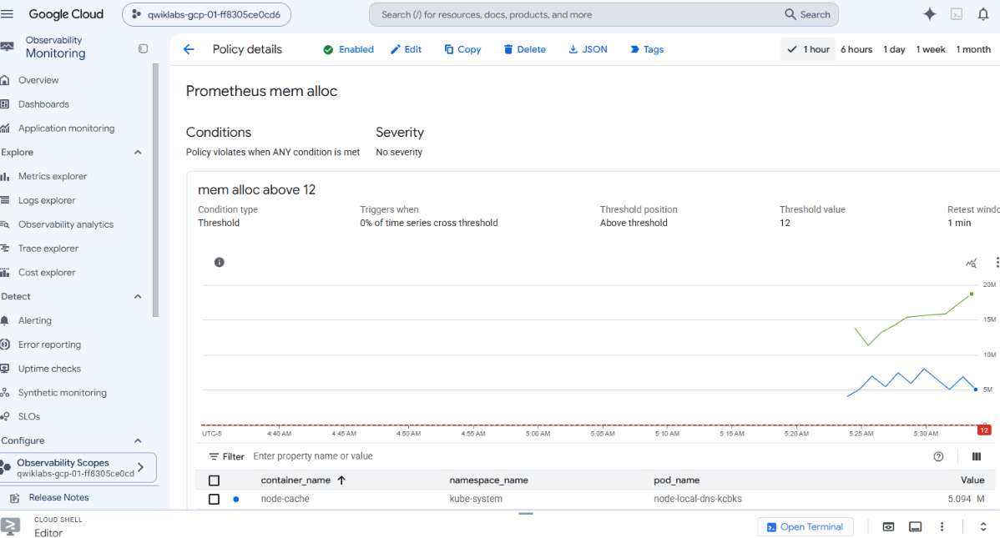
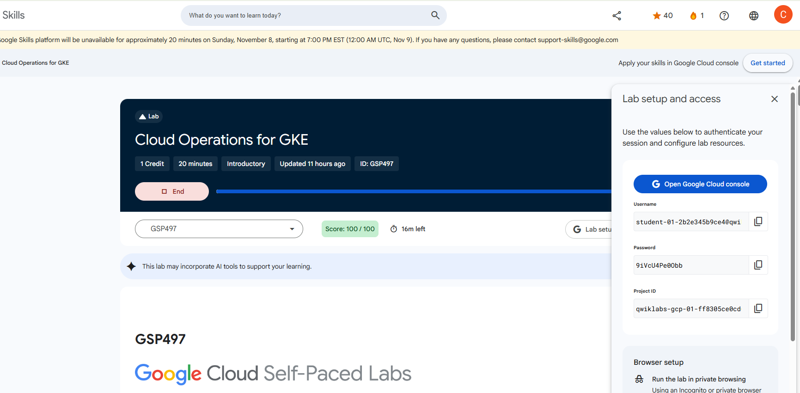

# LAB-05: Infraestructura como Codigo con Terraform

**Curso:** IF-1116 - Topicos de Tecnologias de Informacion  
**Semana:** 09  
**Semestre:** 2026-II  
**Repositorio:** ConnieDR8/ConnieDR8.github.io

## Objetivo

Implementar y administrar infraestructura en Google Cloud mediante Terraform, utilizando configuraciones declarativas, planes de ejecucion, gestion del estado y modulos reutilizables.

## Evidencias

| Laboratorio | Puntaje | Captura | Carpeta | Estado |
|---|---|---|---|---|
| GSP233 | 100/100 (3 puntos) | [Ver evidencia](evidencia/gsp233.png) | [01-gsp233](01-gsp233/) | Completado |
| GSP497 | Por confirmar | [Ver evidencia](evidencia/gsp497.png) | [02-gsp497](02-gsp497/) | Ejecucion completada; puntuacion pendiente de verificar |
| GSP345 | Pendiente | [Ver evidencia](evidencia/gsp345.png) | [03-gsp345](03-gsp345/) | Pendiente |

## Bitacora

### GSP233 - Kubernetes Load Balancer

**Fecha:** 06/11/2026  
**Resultado:** 100/100

**Objetivo:** Desplegar un cluster GKE mediante Terraform y publicar NGINX usando un servicio Kubernetes de tipo LoadBalancer.

**Actividades realizadas:**

1. Se inicio el laboratorio en Google Skills utilizando las credenciales temporales.
2. Se descargo el proyecto oficial `tf-gke-k8s-service-lb`.
3. Se revisaron los archivos `main.tf`, `k8s.tf` y `versions.tf`.
4. Se ejecuto `terraform init` para inicializar el entorno.
5. Se reviso el plan generado por Terraform antes de confirmar su ejecucion.
6. Se ejecuto `terraform apply` con la region y zona de la sesion.
7. Se verifico la creacion del cluster GKE y la respuesta HTTP de NGINX.
8. Se comprobo la puntuacion final del laboratorio: 100/100.

**Configuracion utilizada:**

| Parametro | Valor |
|---|---|
| Proyecto temporal | `qwiklabs-gcp-01-90eee82429b5` |
| Region | `us-central1` |
| Zona | `us-central1-c` |
| Cluster | `tf-gke-k8s` |
| Nodos | 3 |
| Provider Google | `8.10.0` |
| Provider Kubernetes | `1.10.0` |
| IP externa | `34.133.18.112` |

**Comandos principales:**

~~~bash
terraform init

terraform apply -var="region=us-central1" -var="location=us-central1-c"

curl http://34.133.18.112
~~~

**Revision del plan:**

El resultado previo a confirmar el despliegue fue:

~~~text
Plan: 7 to add, 0 to change, 0 to destroy.
~~~

Se verifico que Terraform no planificara modificaciones ni destrucciones.

El contenido se conserva en `01-gsp233/plan-inicial.txt`. El plan fue capturado de la salida de `terraform apply`, antes de introducir `yes`, y no de una ejecucion independiente de `terraform plan`.

**Verificacion del servicio:**

La respuesta HTTP incluyo:

~~~html
<h1>Welcome to nginx!</h1>
~~~

Esto confirmo que el servicio NGINX era accesible mediante la IP externa del balanceador.

**Dificultades:**

Durante un primer intento, Cloud Shell no tenia configurado el Project ID y Terraform no pudo identificar el proyecto de Google Cloud. Ademas, se presento un bloqueo temporal del estado durante una operacion de planificacion.

La primera sesion finalizo antes de completar el laboratorio.

**Solucion aplicada:**

Se identifico el problema del proyecto mediante `gcloud config get-value project` y se utilizo `gcloud config set project` para establecer el identificador temporal correcto.

Posteriormente se ejecuto nuevamente el laboratorio en una sesion independiente, se completo el despliegue y se obtuvo 100/100.

**Que cambiaria:**

Verificaria el Project ID desde el inicio y conservaria los archivos de evidencia durante la ejecucion, para evitar depender del tiempo restante de Cloud Shell.

**Archivos entregados:**

- `01-gsp233/main.tf`
- `01-gsp233/k8s.tf`
- `01-gsp233/versions.tf`
- `01-gsp233/plan-inicial.txt`

**Captura del resultado:**



**Captura del cluster GKE:**



### GSP497 - Cloud Operations for GKE

**Fecha de ejecucion:** 06/11/2026  
**Puntuacion Google Skills:** 100/100

**Objetivo:**

Implementar un cluster de Google Kubernetes Engine (GKE) con Terraform, desplegar una aplicacion de demostracion, verificar sus metricas en Cloud Monitoring y eliminar los recursos al finalizar.

**Actividades realizadas:**

1. Se inicio GSP497 utilizando una cuenta temporal de Google Skills.
2. Se descargo y descomprimio el proyecto oficial `gke-monitoring-tutorial`.
3. Se reviso la estructura de Terraform y el script `scripts/create.sh`.
4. Se generaron las variables de configuracion para el laboratorio.
5. Se ejecuto `terraform init` para inicializar los providers.
6. Se genero y reviso `plan-inicial.txt` antes del despliegue.
7. Se ejecuto `make create` para implementar la infraestructura.
8. Se ejecuto `make validate` para verificar la aplicacion.
9. Se reviso la politica `Prometheus mem alloc` y sus metricas en Cloud Monitoring.
10. Se ejecuto `make teardown` y se conservo su salida en `destroy.txt`.

**Configuracion utilizada:**

| Parametro | Valor |
|---|---|
| Herramienta IaC | Terraform |
| Provider Google | 8.10.0 |
| Proyecto temporal | `qwiklabs-gcp-01-ff8305ce0cd6` |
| Zona | `us-east1-c` |
| Cluster | `stackdriver-monitoring-tutorial` |
| Politica de alerta | `Prometheus mem alloc` |
| Condicion | `mem alloc above 12` |
| Duracion de evaluacion | 60 segundos |

**Inicializacion y planificacion:**

Se ejecuto:

~~~bash
cd ~/gke-monitoring-tutorial/terraform
terraform init -input=false
terraform plan -input=false -no-color > plan-inicial.txt 2>&1
~~~

El plan mostro:

~~~text
Plan: 5 to add, 0 to change, 0 to destroy.
~~~

Se reviso que no existieran modificaciones ni destrucciones previstas.

El archivo se conserva en `02-gsp497/plan-inicial.txt`.

**Despliegue y validacion:**

Desde la carpeta principal del proyecto se ejecutaron:

~~~bash
make create
make validate
~~~

La validacion devolvio:

~~~text
Fetching cluster endpoint and auth data.
kubeconfig entry generated for stackdriver-monitoring-tutorial.
App is deployed.
~~~

Este resultado confirmo que la aplicacion se encontraba desplegada.

**Verificacion de Cloud Monitoring:**

Se accedio a la politica `Prometheus mem alloc` en Google Cloud Monitoring.

Se comprobo que la politica estaba habilitada, que existia la condicion `mem alloc above 12` y que se visualizaban series temporales de metricas.

**Evidencia de Monitoring:**



**Destruccion de infraestructura:**

La guia del laboratorio utiliza `make teardown` para eliminar los recursos.

Para conservar la evidencia exigida por la rubrica se ejecuto:

~~~bash
make teardown 2>&1 | tee terraform/destroy.txt
~~~

El resultado final fue:

~~~text
Plan: 0 to add, 0 to change, 5 to destroy.

Destroy complete! Resources: 5 destroyed.
~~~

Se confirmo la eliminacion de los cinco recursos administrados por Terraform.

El registro completo se conserva en `02-gsp497/destroy.txt`.

**Archivos entregados:**

| Archivo | Descripcion |
|---|---|
| `02-gsp497/outputs.tf` | Salidas de la infraestructura. |
| `02-gsp497/provider.tf` | Configuracion del provider. |
| `02-gsp497/resources.tf` | Recursos de infraestructura y Monitoring. |
| `02-gsp497/variables.tf` | Variables utilizadas en la configuracion. |
| `02-gsp497/versions.tf` | Requisitos de version de Terraform. |
| `02-gsp497/plan-inicial.txt` | Plan generado antes del despliegue. |
| `02-gsp497/destroy.txt` | Registro de la eliminacion de recursos. |

**Evidencia de puntuacion:**



**Dificultades:**

Se detecto que el comando `make create` ejecutaba internamente `terraform apply` mediante `scripts/create.sh`, lo que podia impedir guardar el plan de forma independiente antes del despliegue.

Durante la preparacion se interrumpio una primera invocacion de `make create`. Posteriormente se confirmo que las variables de Terraform se habian generado.

**Soluciones aplicadas:**

Se revisaron el Makefile y `scripts/create.sh`, se inicializo Terraform y se genero `plan-inicial.txt` antes de continuar con `make create`.

Para la limpieza, se reviso `scripts/teardown.sh` y se conservo la salida del comando oficial mediante `tee`, sin modificar el script original.

**Que cambiaria:**

Incluiría en el flujo de trabajo la generación automática de plan-inicial.txt antes del despliegue y de destroy.txt durante la limpieza. Esto permitiría mantener un registro completo de las operaciones sin depender de comandos adicionales y facilitaría la revisión de las evidencias.

**Uso de IA**

ChatGPT se utilizo para interpretar los scripts del proyecto, identificar el momento correcto para generar el plan, revisar los cinco recursos previstos y preparar el registro de destruccion.

Las operaciones de despliegue, validacion, Monitoring y destruccion fueron realizadas por el estudiante en Google Cloud.

Las capturas y los registros utilizados proceden de la sesion real del laboratorio.

### GSP345 - Terraform Challenge Lab

**Actividades:** Pendiente.

**Dificultades:** Pendiente.

**Que cambiaria:** Pendiente.

## Uso de IA

Durante el desarrollo del LAB-05 se utilizó ChatGPT como herramienta de apoyo para interpretar instrucciones, analizar comandos de Terraform, resolver dificultades técnicas y organizar las evidencias solicitadas.

La herramienta no ejecutó directamente los laboratorios. Las operaciones en Google Cloud Shell, las comprobaciones en Google Cloud Console y la recopilación de evidencias fueron realizadas por el estudiante.

### GSP233 — Terraform en Google Cloud

**¿Qué le pedí?**

- Interpretar las instrucciones del laboratorio GSP233 y determinar cómo cumplir los requisitos adicionales del profesor.
- Explicar el funcionamiento de los comandos `terraform init`, `terraform plan` y `terraform apply`.
- Ayudar a identificar por qué Cloud Shell no reconocía correctamente el proyecto de Google Cloud.
- Indicar cómo generar el plan inicial antes de aplicar los cambios.
- Orientar la validación del clúster GKE y del servicio NGINX.
- Organizar los archivos Terraform, las capturas y la bitácora del laboratorio.

**¿Qué me dio?**

ChatGPT explicó el orden de ejecución de Terraform y proporcionó comandos para inicializar el proyecto, revisar su configuración y conservar el plan de infraestructura.

Entre los comandos revisados se encuentran:

```bash
gcloud config get-value project
gcloud config set project PROJECT_ID
terraform init
terraform plan
terraform apply
```

También explicó cómo interpretar el resumen del plan, diferenciando los recursos que se crearían, modificarían o destruirían.

Finalmente, orientó la organización de las evidencias dentro de `lab-05/01-gsp233/` y `lab-05/evidencia/`.

**¿Qué corregí?**

- Detecté que los enlaces de GSP233 y GSP497 se habían confundido inicialmente, por lo que verifiqué el laboratorio correcto.
- Configuré manualmente el Project ID cuando comprobé que Cloud Shell no lo tenía establecido.
- Repetí GSP233 en una nueva sesión después de que terminara la primera.
- Revisé el plan de Terraform antes de confirmar el despliegue.
- Verifiqué personalmente el clúster GKE y el acceso al servicio NGINX.
- Conservé las capturas originales y registré la puntuación real de 100/100.

**Resultado:** GSP233 se completó satisfactoriamente y se conservaron los archivos Terraform, el plan inicial y las evidencias del laboratorio.

### GSP497 — Cloud Operations for GKE

**¿Qué le pedí?**

- Revisar el procedimiento de GSP497 e identificar el momento correcto para generar `plan-inicial.txt`.
- Analizar el funcionamiento de `make create`, ya que este comando ejecutaba Terraform automáticamente.
- Ayudar a interpretar el plan y comprobar que no existieran destrucciones imprevistas.
- Explicar cómo verificar el despliegue utilizando `make validate`.
- Identificar la evidencia adecuada de Google Cloud Monitoring.
- Analizar `scripts/teardown.sh` para registrar la destrucción de recursos sin modificar el script original.
- Indicar cómo organizar los archivos y documentar los resultados en el README.

**¿Qué me dio?**

ChatGPT ayudó a interpretar `scripts/create.sh` y a identificar que `make create` ejecutaba internamente `terraform init` y `terraform apply`.

Para generar y conservar el plan antes del despliegue, proporcionó los siguientes comandos:

```bash
cd ~/gke-monitoring-tutorial/terraform
terraform init -input=false
terraform plan -input=false -no-color > plan-inicial.txt 2>&1
grep -E 'Plan:|Error:' plan-inicial.txt
```

El plan obtenido indicó:

```text
Plan: 5 to add, 0 to change, 0 to destroy.
```

Posteriormente, se utilizaron los comandos oficiales para desplegar y validar la infraestructura:

```bash
cd ~/gke-monitoring-tutorial
make create
make validate
```

La validación devolvió el mensaje `App is deployed.`

Para documentar la limpieza, ChatGPT propuso ejecutar el comando oficial y guardar simultáneamente su salida:

```bash
make teardown 2>&1 | tee terraform/destroy.txt
```

Finalmente, se comprobó el resultado:

```bash
grep -E 'Destroy complete!|Error:' terraform/destroy.txt
```

La salida confirmó:

```text
Destroy complete! Resources: 5 destroyed.
```

**¿Qué corregí?**

- Interrumpí una primera ejecución de `make create` al identificar que podía comenzar el despliegue sin haber conservado previamente el plan inicial.
- Comprobé que `terraform.tfvars` se había generado y después ejecuté `terraform init` y `terraform plan` de manera independiente.
- Revisé que el plan correspondiera al proyecto temporal correcto y contemplara cinco recursos nuevos, sin modificaciones ni destrucciones.
- Ejecuté nuevamente `make create` y validé la aplicación desplegada.
- Verifiqué personalmente la política `Prometheus mem alloc` y seleccioné la captura que mostraba sus métricas.
- Revisé el contenido de `scripts/teardown.sh` antes de ejecutar la limpieza.
- Conservé el registro auténtico de `terraform destroy`, confirmando la eliminación de los cinco recursos.
- Organicé los archivos Terraform y las evidencias para incorporarlos al repositorio.

**Resultado:** GSP497 se desplegó, validó y limpió correctamente. Se conservaron el plan inicial, el registro de destrucción y las evidencias de Cloud Monitoring.

### GSP345 — Terraform Challenge Lab

*Pendiente de documentar después de ejecutar el Challenge Lab.*

### Consideraciones sobre el uso de IA

Las respuestas de ChatGPT fueron contrastadas con los comandos ejecutados, los archivos Terraform y los resultados observados en Google Cloud.

Se corrigieron las recomendaciones cuando no coincidían con el estado real del entorno o con las exigencias del laboratorio.

No se utilizaron resultados simulados para sustituir evidencias. Las capturas, los planes y los registros corresponden a ejecuciones reales realizadas por el estudiante.